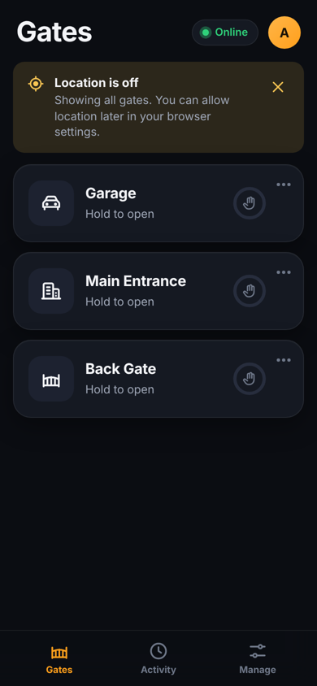
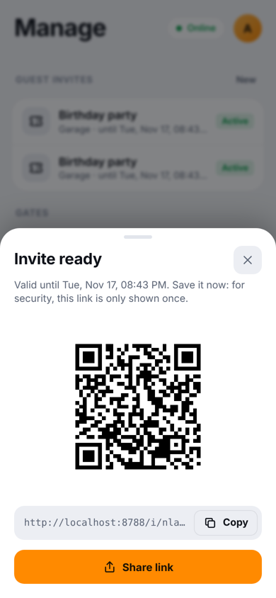
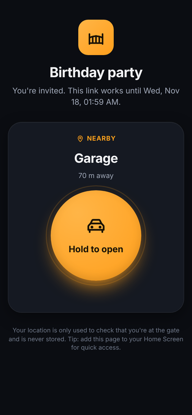
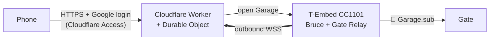

# bruce-gate-relay

[](https://github.com/douglasrolim/bruce-gate-relay/actions/workflows/ci.yml)
[](LICENSE)

**Open your own RF gates from anywhere:** a Cloudflare Worker relay plus a [Bruce](https://github.com/BruceDevices/firmware)
firmware module for the LilyGO T-Embed CC1101.

> [!IMPORTANT]
> **Authorized use only.** Use this only on gates you own or are allowed to operate, with
> **fixed-code** remotes, following your local radio rules, and only when opening the gate is safe.
> No warranty. Read [LEGAL.md](LEGAL.md).

<p align="center">
  
  
  
  
</p>

## How it works



1. You open the web app on your phone and sign in with Google (Cloudflare Access).
2. You **press and hold** a gate. The Worker relays the command to the T-Embed, which keeps an
   outbound WebSocket open (no public IP, no port forwarding).
3. The T-Embed transmits the matching `.sub` file and reports back. The app shows *Signal sent* ✓.
   Fixed-code gates are one-way: the app confirms the **transmission**, not the gate position
   (an optional gate sensor is on the roadmap).

Features: mobile-first PWA (English/Portuguese, light/dark), nearby gates first using your phone's
location, guest invites with QR code and expiry, per-person gate permissions, activity log,
rate limits, and everything on the Cloudflare free plan. Details: [docs/architecture.md](docs/architecture.md).

## Requirements

- [LilyGO T-Embed CC1101](https://lilygo.cc/) with [Bruce firmware](https://bruce.computer/) and the
  gate signals already recorded as `.sub` files (replay must work).
- A [Cloudflare](https://dash.cloudflare.com/sign-up) account and a domain on Cloudflare
  (or `workers.dev`), and a Google account.
- [Node.js](https://nodejs.org/) 22 LTS or newer, [Python 3](https://www.python.org/) with
  [PlatformIO](https://platformio.org/) (`pip install platformio`), and [Git](https://git-scm.com/).

## Quick start

For people who already know Cloudflare and PlatformIO:

```bash
git clone --recursive https://github.com/douglasrolim/bruce-gate-relay && cd bruce-gate-relay/worker
npm install && cp wrangler.toml.example wrangler.toml   # edit: domain, Access team/AUD, emails
npx wrangler login && npx wrangler secret put DEVICE_TOKEN
npm run deploy                                           # then set up Access (docs/authentication.md)
cd .. && python firmware/scripts/gate_relay_fw.py flash --port COM5
# copy firmware/gate-relay.example.json to /gate-relay.json on the device, then RF → Gate Relay
```

## Step-by-step setup

Written for someone who has never used Cloudflare. Use your own domain wherever you see `gate.example.com`.

### 1. Prerequisites

Create a Cloudflare account and add your domain (its *Overview* must say **Active**). Install Node.js,
Python, PlatformIO and Git. Check: `node -v`, `python -m platformio --version`, `git --version`.

### 2. Record and test your gate signals

In Bruce, record each remote (*RF → Scan/copy*), save it, and **test the replay** from the device.
Then create the folder `/BruceRF/gates/` (on the SD card, or LittleFS if you have no card) and copy
each signal there with a friendly name: `Garage.sub`, `Main Entrance.sub`. The file name is the name
shown in the app.

*Fixed code or rolling code?* A fixed-code remote sends the same code every time: Bruce decodes it as
a plain protocol (e.g. *RcSwitch*, 24–28 bits) and the replay opens the gate repeatedly. Rolling-code
remotes (KeeLoq, *Security+*, most modern car and garage remotes) change the code every press, and a
replay does nothing. This project is only for fixed-code remotes.

### 3. Clone the repository

```bash
git clone --recursive https://github.com/douglasrolim/bruce-gate-relay
cd bruce-gate-relay
```

### 4. Configure and deploy the Worker

Follow [docs/setup-cloudflare.md](docs/setup-cloudflare.md). In short: copy `worker/wrangler.toml.example`
to `worker/wrangler.toml` and fill it in (a table there explains every field), `npx wrangler login`,
generate a `DEVICE_TOKEN` (PowerShell and macOS/Linux commands included), `npx wrangler secret put DEVICE_TOKEN`,
and `npm run deploy`.
*Check:* the deploy output lists your custom domain.

### 5. Attach a custom domain

`routes = [{ pattern = "gate.example.com", custom_domain = true }]` makes Cloudflare create the DNS
record and certificate. Make sure no DNS record exists for that name beforehand. Prefer `workers.dev`?
See the note in [docs/setup-cloudflare.md](docs/setup-cloudflare.md#3-custom-domain).

### 6. Set up Cloudflare Access

Follow [docs/authentication.md](docs/authentication.md): create the Zero Trust team (free), create a
Google OAuth client with redirect URI `https://<team>.cloudflareaccess.com/cdn-cgi/access/callback`, add
Google as a login method, create the self-hosted application with an **Allow** policy (your emails), a
**Bypass** application for guest links and static files, and a **Service Token** with a **Service Auth**
policy for the device. Copy the AUD tag and team domain into `wrangler.toml` and deploy again.
*Check:* an incognito window shows the Google login, and other emails are denied.

To **add or remove people** later: edit the Access Allow policy *and* `ALLOWED_EMAILS`, then deploy.

### 7. Build and flash the firmware

Follow [docs/setup-firmware.md](docs/setup-firmware.md): back up the device
(`python -m esptool --port COM5 read_flash 0 ALL flash-backup.bin`), find the port, then
`python firmware/scripts/gate_relay_fw.py flash --port COM5`. If the upload fails, hold **BOOT** while
plugging in USB and try again.

### 8. Configure the device

Copy `firmware/gate-relay.example.json` to `/gate-relay.json` on the SD card (or LittleFS) and fill in
the URL, the device token and the Access service token (field table in
[docs/setup-firmware.md](docs/setup-firmware.md#4-configure-the-device)). Connect Bruce to your Wi-Fi once,
then open **RF → Gate Relay**. The screen should say *Server: Online* and list your gates.

### 9. First use on the phone

Open `https://gate.example.com`, sign in with Google, and add it to your home screen:

- **Android (Chrome):** ⋮ menu → *Add to Home screen* / *Install app*.
- **iPhone (Safari):** Share → *Add to Home Screen*.

Press and hold a gate card for about a second. You'll feel a vibration (Android) and see *Signal sent* ✓.

### 10. Set gate locations (optional, recommended)

Stand at the gate → tap **⋯** on its card → **Set location here** (or **Edit gate settings** to paste
coordinates and adjust the radius, 100 m – 2 km). Nearby gates then move to the top, and a single nearby
gate gets a big button.

### 11. Verify everything

- [ ] The device screen shows *Online*, and the app shows the green *Online* pill and your gates.
- [ ] A gate opens from the phone on mobile data (off your home Wi-Fi).
- [ ] An email that isn't allowed is denied.
- [ ] `curl -i https://gate.example.com/device` (no token) is rejected.
- [ ] Rebooting the router: the device reconnects by itself within a minute.
- [ ] Powering the device off: the app shows *Offline* within ~2 minutes.

## Configuration reference

**Worker (`worker/wrangler.toml` vars and secrets)**

| Name | Type | Required | Default | Example |
|---|---|---|---|---|
| `ENVIRONMENT` | var | yes | `production` | `production` |
| `AUTH_MODES` | var | no | `cloudflare-access` | `cloudflare-access` |
| `ACCESS_TEAM_DOMAIN` | var | yes | – | `myteam.cloudflareaccess.com` |
| `ACCESS_AUD` | var | yes | – | `4f1c9a…` |
| `ALLOWED_EMAILS` | var (CSV) | yes | – | `alice@example.com,bob@example.com` |
| `ADMIN_EMAILS` | var (CSV) | yes | – | `you@example.com` |
| `GATE_PERMISSIONS` | var (JSON) | no | everyone → all gates | `{"bob@example.com":["Garage"]}` |
| `DEVICE_TOKEN` | secret | yes | – | 43 random base64url chars |
| `DEV_USER_EMAIL` | var (dev only) | no | `dev@example.com` | – |

**Device (`/gate-relay.json`)**

| Field | Type | Required | Default | Example |
|---|---|---|---|---|
| `url` | string | yes | – | `wss://gate.example.com/device` |
| `token` | string | yes | – | the `DEVICE_TOKEN` |
| `accessClientId` | string | with Access | – | `abc123.access` |
| `accessClientSecret` | string | with Access | – | `…` |
| `folder` | string | no | `/BruceRF/gates` | `/BruceRF/gates` |
| `caFile` | string | no | – | `/certs/extra.pem` |

## Day-to-day operations

| Task | How |
|---|---|
| Add a gate | Copy `Name.sub` into the gates folder, then restart Gate Relay (it rescans on every connection) |
| Rename a gate | Rename the file *or* set a display name in **⋯ → Edit gate settings**. Renamed files leave orphaned settings: **Manage → Orphaned settings → Move** |
| Add/remove a person | Access Allow policy + `ALLOWED_EMAILS`, then `npm run deploy` |
| Restrict someone to some gates | `GATE_PERMISSIONS` in `wrangler.toml`, then deploy |
| Share with guests | **⋯ → Share with guests** or **Manage → New**; revoke from **Manage** |
| Activity log | **Activity** tab (last 200 opens; IPs visible to admins) |
| Rotate the device token | New token → `wrangler secret put DEVICE_TOKEN` → update `/gate-relay.json` → restart Gate Relay |
| Rotate the Service Token | Create new → add to the Service Auth policy → update the device → delete the old one |
| Back up gate locations | **Manage → Export gate settings** (JSON); restore with *Import* |
| Update Bruce | Rebase your `gate-relay` branch on the new Bruce tag, run `integrate`, build, flash |

## Location and privacy

The app can use your phone's location to put the closest gate first. It asks only after explaining why,
keeps watching only while the page is visible, and never stores your coordinates. When a gate (or an
invite) **requires proximity**, the position is sent with that open request and only the rounded
distance (e.g. "≈150 m") is kept in the log. Browser location can be faked, so proximity is a deterrent
against a forwarded link being used far away, not a security control: the real protection is Cloudflare
Access and the allowlist.

## Tips for parties

- Set the gate location **before** the event, standing at the gate.
- Guests need mobile data at the gate. In weak-signal places, extend the Wi-Fi to the gate or share the
  guest Wi-Fi.
- Test the invite on a second phone before sending it to everyone; keep the validity short.
- Keep the T-Embed on a USB charger, placed where its signal reliably reaches the gate.

## Security model

Cloudflare Access with Google in front, JWT validation in the Worker, an email allowlist, an Access
Service Token **and** a device token for the T-Embed, TLS with pinned roots on the device, CSRF
protection, rate limits and an audit log. See [SECURITY.md](SECURITY.md) for the threat model and known
limitations, and [docs/authentication.md](docs/authentication.md) for the auth roadmap (password, direct
Google OIDC, passkeys, TOTP, API tokens).

## Development

```bash
cd worker && npm install
npm test                                  # unit + integration tests (simulated device)
npm run typecheck && npm run lint
npx tsx ../tools/ui-preview/server.ts     # UI preview at http://localhost:8788, no Cloudflare needed
npm run dev                               # real Workers runtime at http://localhost:8787 (needs .dev.vars)
node ../tools/fake-device/fake-device.mjs --url ws://localhost:8787/device --token <DEVICE_TOKEN>
python ../firmware/scripts/gate_relay_fw.py test   # firmware host tests
```

The fake device supports `--mode ok|fail|timeout|malformed` to exercise error paths.
See [CONTRIBUTING.md](CONTRIBUTING.md).

## Troubleshooting

| Symptom | Likely cause |
|---|---|
| App shows *Offline* | Device not running Gate Relay, no Wi-Fi, wrong `url`/token, or the Service Auth policy is missing. `npx wrangler tail` shows rejected connections |
| *Session expired, reload* | Cloudflare Access session ended: reload to sign in again |
| *This account can't open gates* | Email allowed by Access but missing from `ALLOWED_EMAILS` |
| *No answer from the device* | Device busy or Wi-Fi unstable; check the device screen |
| *Signal sent* but the gate didn't move | Out of radio range, or the `.sub` is a rolling-code/raw capture that doesn't replay |
| Guest link asks for Google login | The Bypass application for `/i/*` and `/api/guest/*` is missing |

## Roadmap

- More auth modes (password, direct Google OIDC, passkeys, TOTP, API tokens for Apple Shortcuts/Home Assistant).
- Optional JavaScript polling script for Bruce (no custom firmware), see the evaluation in
  [docs/architecture.md](docs/architecture.md#alternative-without-a-firmware-fork-evaluated).
- Optional gate position sensor (open/closed), so the app can show the real state.
- Propose the Gate Relay module upstream to Bruce.

## Contributing, license and credits

Contributions are welcome: see [CONTRIBUTING.md](CONTRIBUTING.md). Licensed under the
[GNU AGPL v3.0 or later](LICENSE), the same license as Bruce, because the firmware module is compiled
into it. Copyright (C) 2026 douglasrolim and bruce-gate-relay contributors.

Huge thanks to the [Bruce](https://github.com/BruceDevices/firmware) project and its contributors, whose
firmware does all the radio work. Not affiliated with Bruce, LilyGO, Cloudflare or Google.
