<h1 align="center">bruce-gate-relay</h1>

<p align="center">
  <b>Open your own RF gates from anywhere.</b><br>
  A Cloudflare Worker relay + a <a href="https://github.com/BruceDevices/firmware">Bruce</a> firmware module
  for Sub-GHz Bruce devices (tested on the LilyGO T-Embed CC1101).
</p>

<p align="center">
  <a href="https://github.com/douglasrolim/bruce-gate-relay/actions/workflows/ci.yml"></a>
  <a href="https://github.com/douglasrolim/bruce-gate-relay/releases"></a>
  <a href="LICENSE"></a>
</p>

<p align="center">
  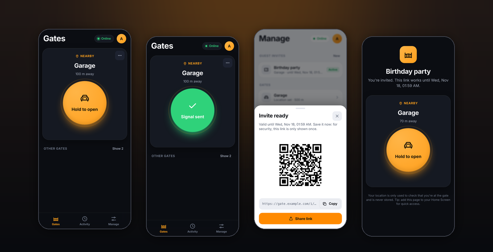
</p>

> [!IMPORTANT]
> **Authorized use only.** Use this only on gates you own or are allowed to operate, with **fixed-code**
> remotes, following your local radio rules, and only when opening the gate is safe. No warranty.
> Read [LEGAL.md](LEGAL.md).

## Contents

- [Features](#features)
- [How it works](#how-it-works)
- [Supported hardware](#supported-hardware)
- [What you need](#what-you-need)
- [Installation](#installation)
  - [1. Record your gate signals](#1-record-your-gate-signals)
  - [2. Get the code](#2-get-the-code)
  - [3. Deploy the Worker](#3-deploy-the-worker)
  - [4. Protect it with Cloudflare Access](#4-protect-it-with-cloudflare-access)
  - [5. Install the firmware](#5-install-the-firmware)
  - [6. Configure the device](#6-configure-the-device)
  - [7. Install the app on your phone](#7-install-the-app-on-your-phone)
  - [8. Check that everything works](#8-check-that-everything-works)
- [Using the app](#using-the-app)
- [Updating](#updating)
- [Configuration reference](#configuration-reference)
- [Day-to-day operations](#day-to-day-operations)
- [Location and privacy](#location-and-privacy)
- [Security](#security)
- [Troubleshooting](#troubleshooting)
- [Development](#development)
- [Roadmap](#roadmap)
- [License and credits](#license-and-credits)

## Features

- **Press and hold to open**: a big, phone-first button that can't fire by accident in a pocket.
- **Works from anywhere**: the device keeps an outbound connection to Cloudflare. No public IP, no port forwarding.
- **Google sign-in** (or a one-time code by email) through Cloudflare Access, plus an email allowlist checked by the Worker.
- **Nearby gates first**: the phone's location puts the closest gate on top; one nearby gate gets a big round button.
- **Guest invites**: time-boxed links with a QR code for parties and visits. No accounts, revocable, optionally only near the gate.
- **Activity log**: who opened which gate, when, and whether it worked.
- **Per-person permissions**: limit someone to certain gates.
- **Installable app (PWA)**: full screen from the home screen, light and dark mode, English and Portuguese (follows the phone).
- **Everything on the Cloudflare free plan**, and ready-to-flash firmware published automatically for every new Bruce release.

## How it works

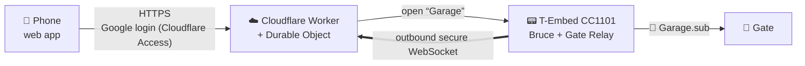

1. You open the web app and sign in with Google (handled by Cloudflare Access).
2. You **press and hold** a gate. The Worker relays the command to the T-Embed over the WebSocket the
   device keeps open.
3. The T-Embed transmits the matching `.sub` recording and reports back. The app shows **Signal sent** ✓.

> [!NOTE]
> **"Signal sent" is not "gate open".** Fixed-code remotes are one-way: the device knows that it
> transmitted, not where the gate is. A gate position sensor is on the [roadmap](#roadmap).

Protocol, API and code map: [docs/architecture.md](docs/architecture.md).

## Supported hardware

Gate Relay is a Bruce module, so it runs on Bruce devices that have **Wi-Fi** (every ESP32 does) and a
**Sub-GHz radio**. The radio can be built in (a CC1101 chip) or an external module that Bruce supports: a
CC1101 on SPI, or a simple 433 MHz transmitter. You pick it in Bruce under **Config → RF**. Gate Relay
transmits through Bruce's own RF code, so whatever replays your `.sub` file in Bruce also works here.

Every [release](https://github.com/douglasrolim/bruce-gate-relay/releases) includes an image for each board
in [`firmware/BOARDS`](firmware/BOARDS):

| Device | Bruce env | Sub-GHz radio | Status |
|---|---|---|---|
| LilyGO T-Embed CC1101 / CC1101 Plus | `lilygo-t-embed-cc1101` | built-in CC1101 | ✅ tested |
| Bruce Reaper RF | `reaper` | built-in CC1101 | 🧪 builds |
| Smoochiee V2 | `smoochiee-board` | built-in CC1101 | 🧪 builds |
| ESP32-C5 | `esp32-c5` | CC1101 | 🧪 builds |
| M5Stack Cardputer / Cardputer Adv | `m5stack-cardputer` | external module | 🧪 builds |
| M5Stack StickS3, StickC Plus 2, StickC Plus 1.1 | `m5stack-sticks3`, `m5stack-cplus2`, `m5stack-cplus1_1` | external module | 🧪 builds |
| M5Stack Core, Core2, CoreS3 / SE | `m5stack-core16mb`, `m5stack-core2`, `m5stack-cores3` | external module | 🧪 builds |
| CYD-2432S028, CYD-3248S035 ("Cheap Yellow Display") | `CYD-2432S028`, `CYD-3248S035R` | external module | 🧪 builds |
| LilyGO T-LoRa Pager, T-Display-S3 | `lilygo-t-lora-pager`, `lilygo-t-display-s3` | external module | 🧪 builds |
| Elecrow 24B, Advance 3.5" S3 | `elecrow-24B`, `elecrow-advance-35-s3` | external module | 🧪 builds |

**✅ tested** means opened a real gate. **🧪 builds** means the image compiles in CI, but nobody has
reported it on hardware yet. The release notes list the boards that built for that Bruce version. Tried
it on one of these? Please open an issue or a PR to mark it tested. For wiring an external module, see Bruce's
[connection diagrams](https://github.com/BruceDevices/firmware/tree/main/media/connections) and
[wiki](https://wiki.bruce.computer), and the device list at [bruce.computer/boards](https://bruce.computer/boards).

Notes:

- A **simple 433 MHz transmitter** only sends on its own frequency (usually 433.92 MHz) with ASK/OOK. That
  covers most fixed-code gates in Brazil and Europe. Remotes on 315, 390 or 868 MHz need a CC1101.
- Boards with 4 MB of flash have less room. If one of them stops building, it's dropped from that release
  and the notes say so.
- To add a board, add its Bruce env to `firmware/BOARDS`. The next release builds it.

## What you need

| | Item | Notes |
|---|---|---|
| 📟 | A [supported Bruce device](#supported-hardware) with a Sub-GHz radio (e.g. [LilyGO T-Embed CC1101](https://lilygo.cc/)) | Your gate signals already recorded and **tested** (replay must open the gate) |
| ☁️ | [Cloudflare account](https://dash.cloudflare.com/sign-up) + a domain on it | Free plan. `workers.dev` also works, see [docs/setup-cloudflare.md](docs/setup-cloudflare.md#3-custom-domain) |
| 🔑 | A Google account | For the Google login (optional: one-time codes by email work without it) |
| 💻 | [Node.js](https://nodejs.org/) 22+ and [Git](https://git-scm.com/) | To deploy the Worker |
| 🐍 | [Python 3](https://www.python.org/) + `pip install esptool` | To flash the firmware. Add `platformio` only if you build it yourself |
| 🔌 | USB-C cable and a 5 V charger | The device stays powered near the gate |

Plan about **1–2 hours** the first time. Everything is free.

## Installation

> [!TIP]
> **First time?** The [complete walkthrough](docs/walkthrough.md) covers the whole process in order, as done on
> a real device: backups, Cloudflare, building and flashing, copying the config over USB and the first open,
> plus every pitfall we hit on Windows. The steps below are the summary.

### 1. Record your gate signals

1. In Bruce, record each remote (**RF → Scan/Copy**), save it and **replay it** from the device: the
   gate must open. Only fixed-code remotes work (see below).
2. Put the recordings in **`/BruceRF/gates/`** with friendly names: `Garage.sub`, `Main Entrance.sub`.
   The file name is the name shown in the app. Use the SD card, or the internal LittleFS if you have no card.
   You can do it on the device, with Bruce's WebUI, or from the PC over USB with
   [`tools/bruce-serial`](tools/bruce-serial/bruce_serial.py) (`pip install pyserial`):

   ```bash
   python tools/bruce-serial/bruce_serial.py --port COM5 mkdir /BruceRF/gates
   python tools/bruce-serial/bruce_serial.py --port COM5 cp /BruceRF/rcs.sub /BruceRF/gates
   python tools/bruce-serial/bruce_serial.py --port COM5 mv /BruceRF/gates/rcs.sub "/BruceRF/gates/Garage.sub"
   ```

<details>
<summary><b>Fixed code or rolling code?</b></summary>

A **fixed-code** remote sends the same code every time. Bruce decodes it as a plain protocol (for example
*RcSwitch*, 24–28 bits) and replaying the recording opens the gate every time. **Rolling-code** remotes
(KeeLoq, Security+, most modern car and garage remotes) change the code on every press, so a replay does
nothing. This project is only for fixed-code remotes, and does not try to defeat rolling codes.
</details>

### 2. Get the code

```bash
git clone https://github.com/douglasrolim/bruce-gate-relay
cd bruce-gate-relay/worker
npm install
```

### 3. Deploy the Worker

```bash
cp wrangler.toml.example wrangler.toml     # your private settings (gitignored)
npx wrangler login                         # opens the browser
```

Edit `wrangler.toml`: your hostname in `routes` (e.g. `gate.example.com`), `ALLOWED_EMAILS` and
`ADMIN_EMAILS`. The Access fields are filled in step 4. Every field is explained in
[docs/setup-cloudflare.md](docs/setup-cloudflare.md#1-configure).

Create the **device token**, a random secret shared by the Worker and the device:

```powershell
# Windows PowerShell
$b = New-Object byte[] 32; [Security.Cryptography.RandomNumberGenerator]::Fill($b); [Convert]::ToBase64String($b).TrimEnd('=').Replace('+','-').Replace('/','_')
```

```bash
# macOS / Linux
openssl rand -base64 32 | tr '+/' '-_' | tr -d '='
```

Keep it somewhere safe (you'll need it in step 6), then:

```bash
npx wrangler secret put DEVICE_TOKEN       # paste the token
npm run deploy
```

✅ The output ends with your custom domain. Cloudflare creates the DNS record and the certificate for you.

### 4. Protect it with Cloudflare Access

In the Cloudflare dashboard, **Zero Trust** (free up to 50 users). The full click-by-click guide is in
[docs/authentication.md](docs/authentication.md). In short:

1. **Team**: create it and note the team domain, `<team>.cloudflareaccess.com`.
2. **Google login**: in [Google Cloud Console](https://console.cloud.google.com/), create an OAuth client
   (*Web application*) with the redirect URI `https://<team>.cloudflareaccess.com/cdn-cgi/access/callback`,
   then add it under **Zero Trust → Settings → Authentication → Google**. Optionally enable **One-time PIN** too.
3. **Application** (self-hosted) for `gate.example.com`, with a 1-month session, an **Allow** policy with
   your emails, and a **Service Auth** policy for the device's **Service Token** (create one named `t-embed-relay`
   and copy its Client ID and Secret; the secret is shown only once).
4. **Second application** for the guest links and static files, with a **Bypass** policy:
   `/i`, `/guest`, `/guest.webmanifest`, `/api/guest`, `/assets`, `/sw.js`, `/manifest.webmanifest`.
5. Copy the application's **AUD tag** and the team domain into `wrangler.toml`, then `npm run deploy` again.

✅ An incognito window on `https://gate.example.com` now shows the login page. The app opens and says
**Offline**, because the device isn't connected yet.

### 5. Install the firmware

Back up the device first. The backup restores everything exactly as it was:

```bash
python tools/bruce-serial/bruce_serial.py --port COM5 info                    # note the Bruce version
python tools/bruce-serial/bruce_serial.py --port COM5 backup-subs backup/sub  # every .sub, MD5-checked
python -m esptool --port COM5 read-flash 0 ALL backup/flash.bin               # full 16 MB image
```

Find the port in Windows Device Manager → *Ports (COM & LPT)* → "USB Serial Device" (VID 303A).
Bluetooth COM ports are not it. On Linux the port is `/dev/ttyACM0`, on macOS `/dev/cu.usbmodem*`.

**Option A: download a ready-made build (recommended).** Get the latest
`bruce-<version>-gate-relay-<board>.bin` for your board (e.g. `…-lilygo-t-embed-cc1101.bin`) from
[Releases](https://github.com/douglasrolim/bruce-gate-relay/releases), check it against the `.sha256` file, and flash it:

```bash
python -m esptool --port COM5 write-flash 0x0 bruce-1.16.1-gate-relay-lilygo-t-embed-cc1101.bin
```

**Option B: build it yourself** (needs `pip install platformio`, and on Windows PowerShell or cmd, not Git Bash):

```bash
python firmware/scripts/gate_relay_fw.py flash --port COM5                           # T-Embed CC1101 (default)
python firmware/scripts/gate_relay_fw.py flash --port COM5 --env m5stack-cardputer   # any env from firmware/BOARDS
```

The script downloads the Bruce version in [`firmware/BRUCE_VERSION`](firmware/BRUCE_VERSION), adds the
module, builds and uploads. The first build downloads the ESP32 toolchain and takes a while. Details and
Windows notes: [docs/setup-firmware.md](docs/setup-firmware.md).

Both options keep your files (`.sub`, settings) on the SD card and LittleFS. If the upload fails, unplug
the device, **hold BOOT** while plugging it back in, and try again.

### 6. Configure the device

1. Copy [`firmware/gate-relay.example.json`](firmware/gate-relay.example.json), fill it in, and put it at
   **`/gate-relay.json`** on the device (SD card root, or LittleFS root without a card), for example over USB with
   `python tools/bruce-serial/bruce_serial.py --port COM5 push gate-relay.json /gate-relay.json` (MD5-checked):

   ```json
   {
     "url": "wss://gate.example.com/device",
     "token": "<the DEVICE_TOKEN from step 3>",
     "accessClientId": "<service token Client ID>.access",
     "accessClientSecret": "<service token Client Secret>",
     "folder": "/BruceRF/gates"
   }
   ```

2. In Bruce, connect to your Wi-Fi once (**WiFi → Connect**) so the network is saved.
3. Open **RF → Gate Relay** and accept the notice. The screen shows Wi-Fi, IP, **Server: Online** and
   the number of gates.
4. Optional: make it a dedicated relay with **Config → Startup App → Gate Relay** (starts on every boot).

### 7. Install the app on your phone

Open `https://gate.example.com`, sign in, and add it to the home screen:

- **Android (Chrome):** ⋮ menu → *Add to Home screen* / *Install app*.
- **iPhone (Safari):** Share → *Add to Home Screen*.

It now opens full screen like an app and stays signed in for a month.

### 8. Check that everything works

- [ ] The device says **Server: Online**, and the app shows the green **Online** pill and your gates.
- [ ] Holding a gate shows **Signal sent** and the gate opens. Try it on mobile data, away from your Wi-Fi.
- [ ] An email that isn't allowed is refused at the login.
- [ ] `curl -i https://gate.example.com/device` (no credentials) is rejected.
- [ ] After a router reboot, the device reconnects by itself within a minute.
- [ ] With the device off, the app shows **Offline** within about 2 minutes.

## Using the app

<table>
  <tr>
    <td align="center" width="33%">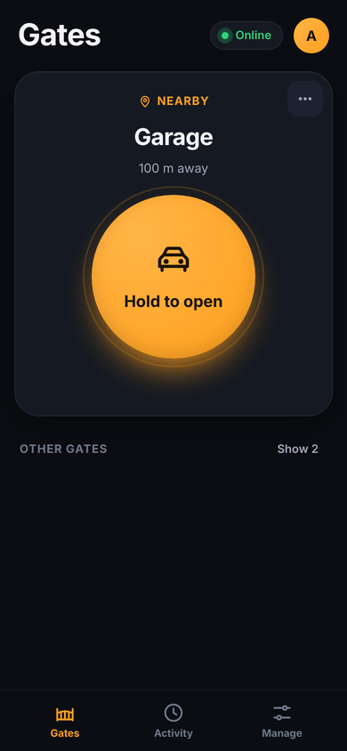<br><sub><b>Nearby gate</b>: one big button</sub></td>
    <td align="center" width="33%">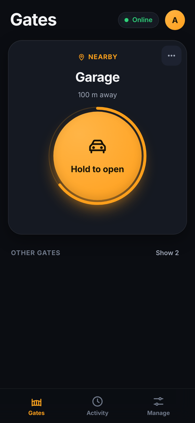<br><sub><b>Hold</b> until the ring fills</sub></td>
    <td align="center" width="33%">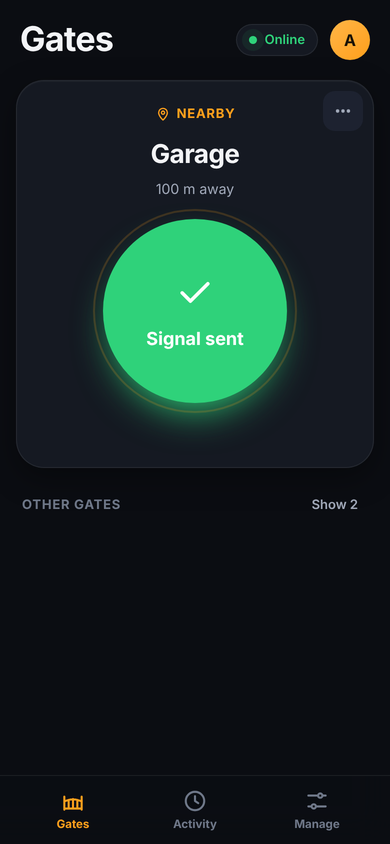<br><sub><b>Signal sent</b> ✓</sub></td>
  </tr>
  <tr>
    <td align="center">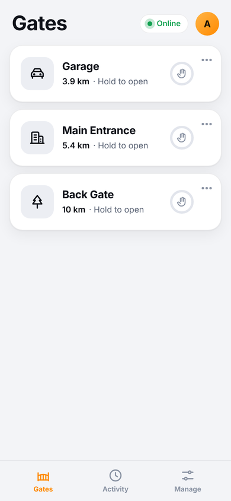<br><sub>All gates, closest first (light mode)</sub></td>
    <td align="center">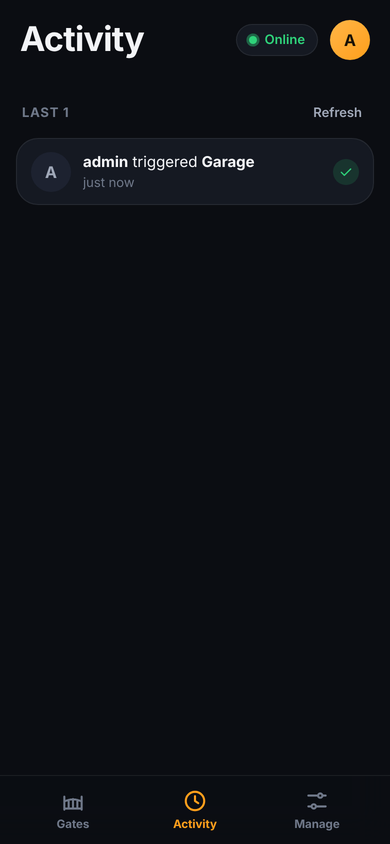<br><sub><b>Activity</b>: who, which gate, when</sub></td>
    <td align="center"><br><sub>What a <b>guest</b> sees</sub></td>
  </tr>
</table>

| You want to… | Do this |
|---|---|
| **Open a gate** | **Press and hold** the gate for about a second, until the ring fills. Letting go early cancels. On a computer, click and hold, or focus the card and press **Enter twice** |
| Know if it worked | Green with **Signal sent** (and a vibration on Android). Red means it failed, with the reason: *Device offline*, *No answer from the device*, *Too far*… |
| See the closest gate first | Allow location when the app asks. Your location stays on your phone |
| See the other gates | When a gate is nearby, the rest are under **Other gates → Show** |
| See who opened what | **Activity** tab |
| Sign out | Tap your initial (top right) → **Sign out** |

### For admins

People in `ADMIN_EMAILS` also get a **⋯** button on every gate and a **Manage** tab.

<table>
  <tr>
    <td align="center" width="33%">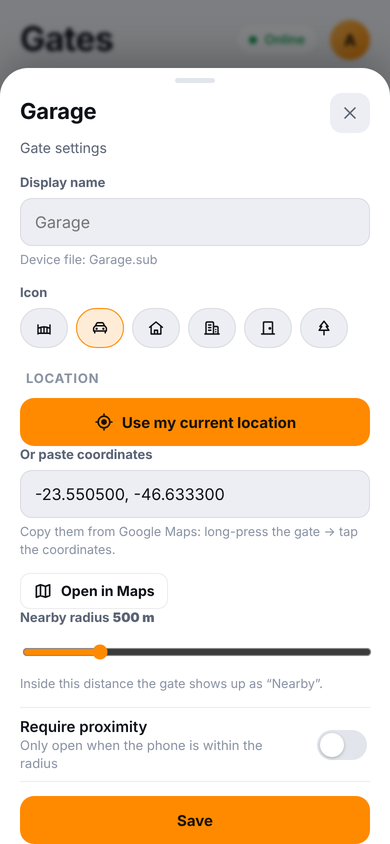<br><sub><b>⋯ → Edit gate settings</b></sub></td>
    <td align="center" width="33%">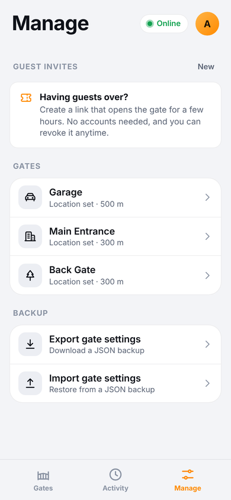<br><sub><b>Manage</b>: invites, gates, backup</sub></td>
    <td align="center" width="33%">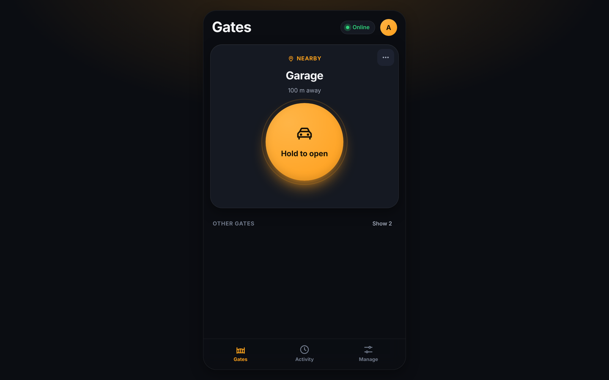<br><sub>Also works on a computer</sub></td>
  </tr>
</table>

- **⋯ → Set location here**: stand at the gate and tap it. The app warns you when the GPS fix is weak (worse than ±50 m).
- **⋯ → Edit gate settings**: display name, icon, location (or paste coordinates from Google Maps), the
  *nearby* radius (100 m – 2 km) and **Require proximity** (the gate only opens within the radius).
- **Manage**: guest invites, gate settings, *orphaned settings* left by renamed `.sub` files, and a JSON
  export/import of the gate settings.

### Guests: parties, visits, deliveries

<table>
  <tr>
    <td align="center" width="33%">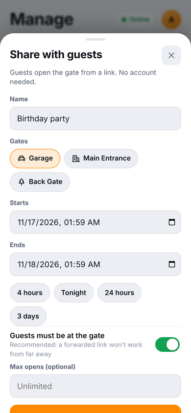<br><sub>1. Create the invite</sub></td>
    <td align="center" width="33%">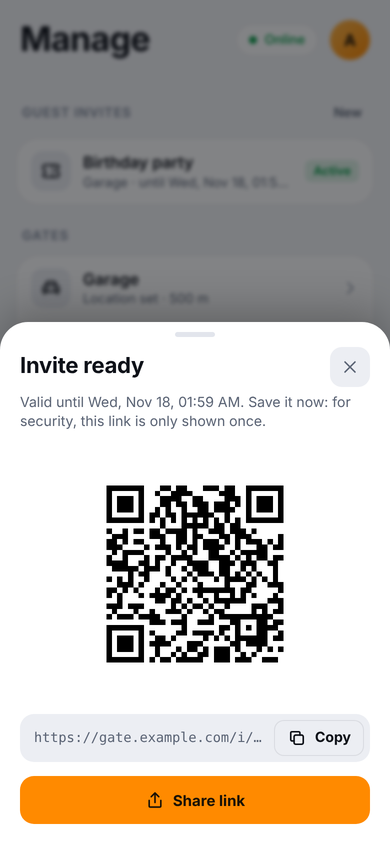<br><sub>2. Share the link or QR code</sub></td>
    <td align="center" width="33%"><br><sub>3. The guest holds to open</sub></td>
  </tr>
</table>

1. **Manage → New** (or **⋯ → Share with guests** on a gate). Pick a name ("Birthday party"), the gates, the
   start and the end (quick buttons: 4 hours, Tonight, 24 hours, 3 days), and optionally a maximum number of opens.
   Keep **Guests must be at the gate** on, so a forwarded link doesn't work from far away.
2. **Create invite**, then **Share link** (WhatsApp and so on) or show the **QR code**. The link is shown
   **only once** (only a hash is stored), so share or save it right away.
3. The guest opens the link: no account, no app to install. They allow location and hold the gate.
4. The link stops working at the end time, after the maximum number of opens, or as soon as you **revoke** it
   in **Manage**. Guest opens appear in **Activity** with the invite name.

**Party tips:** set the gate location before the event, standing at the gate. Test the invite on a second
phone. Guests need mobile data at the gate. Keep the T-Embed on a charger, where its signal reaches the gate.

## Updating

**Firmware.** A [GitHub Action](.github/workflows/release.yml) checks every week for a new Bruce release,
builds it with the Gate Relay module and publishes the `.bin` under
[Releases](https://github.com/douglasrolim/bruce-gate-relay/releases). If the build breaks, it opens an issue
instead. To update, flash the new `.bin` as in [step 5](#5-install-the-firmware). Your files stay.

> [!WARNING]
> Updating with the **official Bruce installer** (Web Flasher or Bruce's own updater) installs Bruce
> **without** Gate Relay, and your gates stop working until you flash a Gate Relay build again.

**Worker.** `git pull`, then `cd worker && npm install && npm run deploy`.

## Configuration reference

<details open>
<summary><b>Worker: <code>worker/wrangler.toml</code> vars and secrets</b></summary>

| Name | Type | Required | Default | Example |
|---|---|---|---|---|
| `routes` | route | yes | – | `[{ pattern = "gate.example.com", custom_domain = true }]` |
| `ENVIRONMENT` | var | yes | `production` | `production` |
| `AUTH_MODES` | var | no | `cloudflare-access` | `cloudflare-access` |
| `ACCESS_TEAM_DOMAIN` | var | yes | – | `myteam.cloudflareaccess.com` |
| `ACCESS_AUD` | var | yes | – | `4f1c9a…` |
| `ALLOWED_EMAILS` | var (comma-separated) | yes | – | `alice@example.com,bob@example.com` |
| `ADMIN_EMAILS` | var (comma-separated) | yes | – | `you@example.com` |
| `GATE_PERMISSIONS` | var (JSON) | no | everyone → every gate | `{"bob@example.com":["Garage"],"*":["Garage","Main Entrance"]}` |
| `DEVICE_TOKEN` | secret | yes | – | 43 random characters |
</details>

<details open>
<summary><b>Device: <code>/gate-relay.json</code></b></summary>

| Field | Required | Default | Description |
|---|---|---|---|
| `url` | yes | – | `wss://gate.example.com/device` |
| `token` | yes | – | The `DEVICE_TOKEN` |
| `accessClientId` | with Access | – | Service token Client ID |
| `accessClientSecret` | with Access | – | Service token Client Secret |
| `folder` | no | `/BruceRF/gates` | The only folder gates are read from |
| `caFile` | no | – | Extra PEM root certificate(s) for unusual certificate authorities |
</details>

## Day-to-day operations

| Task | How |
|---|---|
| Add a gate | Copy `Name.sub` into the gates folder, then restart Gate Relay (it rescans on every connection) |
| Rename a gate | Set a display name in **⋯ → Edit gate settings**, or rename the file. Renaming the file leaves *orphaned settings*: **Manage → Orphaned settings → Move** |
| Add or remove a person | Edit the Access **Allow** policy *and* `ALLOWED_EMAILS`, then `npm run deploy` |
| Limit someone to some gates | `GATE_PERMISSIONS` in `wrangler.toml`, then deploy |
| Rotate the device token | New token → `npx wrangler secret put DEVICE_TOKEN` → update `/gate-relay.json` → restart Gate Relay |
| Rotate the Service Token | Create a new one → add it to the Service Auth policy → update the device → delete the old one |
| Back up gate locations | **Manage → Export gate settings**. Restore with *Import* |
| Watch live logs | `cd worker && npx wrangler tail` |

## Location and privacy

The app asks for location only after explaining why, and stops watching when it isn't on screen.
Coordinates never leave the phone, with one exception: opening a gate that **requires proximity**. Even
then, only the rounded distance (for example "≈150 m") is kept in the activity log. Browser location can be
faked, so proximity is a deterrent against a forwarded link, not a security control. The real protection
is Cloudflare Access plus the allowlist.

## Security

Cloudflare Access in front, JWT validation in the Worker, an email allowlist, a Service Token **and** a
device token for the T-Embed, TLS with pinned root certificates on the device, CSRF protection, rate limits
(3 s per gate, 20 opens per person per hour) and an audit log. The threat model and its limits are in
[SECURITY.md](SECURITY.md). Authentication options and the roadmap (password, direct Google OIDC, passkeys)
are in [docs/authentication.md](docs/authentication.md).

## Troubleshooting

| Symptom | Likely cause |
|---|---|
| App shows **Offline** | Gate Relay isn't running, no Wi-Fi, a wrong `url`/token, or the Service Auth policy is missing. `npx wrangler tail` shows rejected connections |
| Device shows `Server: Retry in …` | Same as above; also check that the Wi-Fi has internet access |
| Device shows `Gates: 0` | Files must end in `.sub` and sit directly in the gates folder |
| *Session expired, reload* | Your Cloudflare Access session ended: reload and sign in |
| *This account can't open gates* | The email passed Access but is missing from `ALLOWED_EMAILS` |
| *No answer from the device* | The device is busy or its Wi-Fi is unstable |
| **Signal sent** but the gate didn't move | Out of radio range, or the recording doesn't replay (rolling code or a raw capture) |
| A guest link asks for a login | The Bypass application for `/i` and `/api/guest` is missing |
| `/device` answers `401` with an HTML *Cloudflare Access* page | The Service Auth policy is missing or the service token secret is wrong (a JSON `401` comes from the Worker instead) |
| Device reboots (orange screen) after Wi-Fi connects | Decode the backtrace, see the [walkthrough](docs/walkthrough.md#8-first-open) |
| Build fails on Windows | Use PowerShell or cmd, and see the [Windows notes](docs/setup-firmware.md#windows-notes) |

## Development

```bash
cd worker && npm install
npm test                                   # unit + integration tests with a simulated device
npm run typecheck && npm run lint
npx tsx ../tools/ui-preview/server.ts      # click through the UI at http://localhost:8788, no Cloudflare needed
npm run dev                                # real Workers runtime at http://localhost:8787 (copy .dev.vars.example)
node ../tools/fake-device/fake-device.mjs --url ws://localhost:8787/device --token <DEVICE_TOKEN>
python ../firmware/scripts/gate_relay_fw.py test   # firmware unit tests (needs gcc: WSL/MinGW on Windows)
python ../tools/bruce-serial/bruce_serial.py --port COM5 ls /BruceRF/gates   # talk to Bruce's serial CLI
```

The fake device supports `--mode ok|fail|timeout|malformed`. See [CONTRIBUTING.md](CONTRIBUTING.md),
[docs/architecture.md](docs/architecture.md) and [docs/setup-firmware.md](docs/setup-firmware.md).

## Roadmap

- Gate position sensor (open/closed), so the app can show the real state.
- More sign-in options: password, direct Google OIDC, passkeys, TOTP, API tokens for Apple Shortcuts and Home Assistant.
- An optional Bruce JavaScript polling script, for people who don't want custom firmware
  ([evaluation](docs/architecture.md#alternative-without-a-firmware-fork-evaluated)).
- Propose the Gate Relay module upstream to Bruce.

## License and credits

Licensed under the [GNU AGPL v3.0 or later](LICENSE), the same license as Bruce, because the firmware
module is compiled into it. [LEGAL.md](LEGAL.md) is a notice and disclaimer, not extra license terms.
Copyright (C) 2026 douglasrolim and bruce-gate-relay contributors. The web app links back to this repository
on every screen, so anyone using a deployment can find the source code.

Huge thanks to the [Bruce](https://github.com/BruceDevices/firmware) project and its contributors, whose
firmware does all the radio work. Not affiliated with Bruce, LilyGO, Cloudflare or Google.
