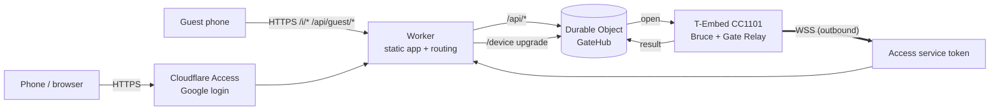

# Architecture



- The **device initiates** a WebSocket (`wss://`) to the Worker and keeps it open: no public IP or
  port forwarding. Cloudflare Access lets it through with a *service token*, then the Worker checks the
  `DEVICE_TOKEN` bearer secret in constant time.
- One **Durable Object** (`idFromName("main")`) owns the device socket and everything stateful: gate
  metadata, invites, rate limits and the audit log, in its built-in SQLite-backed storage (free plan).
  It uses the **WebSocket Hibernation API**, so an idle connection costs nothing. A Durable Object alarm
  sends a protocol `ping` every 30 s.
- The Worker serves the mobile web app itself (HTML, CSS, JS, icons, manifest, service worker): no CDNs.

## Code map

| Path | Responsibility |
|---|---|
| `worker/src/index.ts` | Worker entry: static assets, device token check, forwards to the hub |
| `worker/src/hub/GateHub.ts` | Durable Object glue (WebSocket hibernation, alarms) |
| `worker/src/app.ts` | Composition root: wires implementations behind interfaces |
| `worker/src/http/` | Router, JSON helpers, typed `HttpError`, CSRF check |
| `worker/src/handlers/` | User, admin and guest HTTP handlers |
| `worker/src/services/OpenGateService.ts` | Use case "open a gate": authorize → proximity → rate limit → device → audit |
| `worker/src/auth/` | `Authenticator` strategies (Access JWT, invite, dev) and `Authorizer`s |
| `worker/src/device/DeviceSession.ts` | `GateGateway`: device status, pending opens, timeouts |
| `worker/src/protocol/messages.ts` | Protocol types and validation |
| `worker/src/security/` | Rate limiter, device token check |
| `worker/src/gates/`, `invites/`, `audit/` | Repositories over a small `KeyValueStore` port |
| `worker/client/` | Browser app (vanilla TypeScript, bundled by `scripts/build-client.mjs`) |
| `firmware/gate_relay/` | Bruce module: `RelayCore` (pure protocol logic), `RelayClient` (WSS), `FsGateRepository`, `BruceRfTransmitter`, `GateRelayScreen`, `GateRelayApp` |

## Protocol (version 1)

JSON text frames over the WebSocket. Every message carries `"v": 1`.

Device → server:

```json
{"v":1,"type":"hello","fw":"bruce-gate-relay/1.0.0","gates":["Garage","Main Entrance"]}
{"v":1,"type":"result","id":"<uuid>","ok":true}
{"v":1,"type":"result","id":"<uuid>","ok":false,"error":"GATE_NOT_FOUND"}
{"v":1,"type":"pong"}
```

Server → device:

```json
{"v":1,"type":"open","id":"<uuid>","gate":"Garage"}
{"v":1,"type":"ping"}
```

Rules:

- A **gate name** is a `.sub` file name without its extension, inside **one allowed folder**
  (default `/BruceRF/gates`). Names are 1–48 characters and may not contain `/ \ : * ? " < > |`,
  control characters, `..`, a leading dot or leading/trailing spaces.
- The device only accepts names it announced in `hello`; it never accepts paths.
- `hello` is sent after every (re)connection, so renamed or new `.sub` files show up automatically.
- Error codes: `GATE_NOT_FOUND`, `INVALID_NAME`, `TX_FAILED`, `BUSY`, `INTERNAL`.
- The server pings every 30 s; a device silent for 100 s is shown as offline. The server waits up to
  10 s for a `result` (`TIMEOUT`).
- The device reconnects with exponential backoff: 2 s, 4 s, 8 s … up to 60 s. It also uses
  WebSocket-level heartbeats to notice half-open connections (for example after a router reboot).
- Messages over 4 KB and unknown types are ignored. The server closes a device that keeps sending
  malformed frames.

Authentication of the handshake: `Authorization: Bearer <DEVICE_TOKEN>` (fallback `?token=`), plus
`CF-Access-Client-Id` / `CF-Access-Client-Secret` for Cloudflare Access.

## HTTP API

| Method | Route | Who | Description |
|---|---|---|---|
| GET | `/`, `/activity`, `/admin` | user | Web app shell |
| GET | `/i/<token>`, `/guest` | guest | Guest app shell |
| GET | `/manifest.webmanifest`, `/guest.webmanifest`, `/sw.js`, `/assets/*` | all | PWA assets |
| GET | `/api/me` | user | `{email, provider, isAdmin}` |
| GET | `/api/status` | user | `{online, lastSeen, fw, gates}` (gates filtered by permission) |
| GET | `/api/gates` | user | `{online, lastSeen, gates: [{name, label?, icon?, lat?, lng?, radiusM?, requireProximity}]}` |
| POST | `/api/open` | user | `{gate, position?: {lat, lng, accuracy}}` → `{ok}` or an error |
| GET | `/api/log` | user | Last opens (IP only for admins) |
| GET | `/api/admin/gates` | admin | Gates, metadata and orphaned entries |
| PUT/DELETE | `/api/admin/gates/:name` | admin | Upsert / remove metadata |
| GET/POST | `/api/admin/export`, `/api/admin/import` | admin | JSON backup of gate metadata |
| GET/POST | `/api/admin/invites` | admin | List / create invites |
| POST | `/api/admin/invites/:id/revoke` | admin | Revoke |
| GET | `/api/guest/gates` | guest | Invited gates (`Authorization: Bearer <invite token>`) |
| POST | `/api/guest/open` | guest | Open an invited gate |
| GET | `/device` | device | WebSocket upgrade |

Errors are JSON: `{"ok": false, "error": "CODE", "message": "…"}` with codes such as `UNAUTHENTICATED`,
`FORBIDDEN`, `GATE_NOT_ALLOWED`, `LOCATION_REQUIRED`, `TOO_FAR`, `COOLDOWN`, `RATE_LIMITED`,
`DEVICE_OFFLINE` (503), `TIMEOUT` (504), `TX_FAILED` (502), `INVITE_EXPIRED`, `INVITE_INVALID`,
`BAD_ORIGIN`, `BAD_REQUEST`.

## Alternative without a firmware fork (evaluated)

Bruce 1.16.1's JavaScript interpreter exposes `wifi.httpFetch(url, {headers, …})` and
`subGHz.transmitFile(path)` (which calls `subghz tx_from_file`). A script could therefore **poll** the
Worker (e.g. every 2 s) and transmit. It would avoid a custom build, but costs latency, battery and
requests, has no persistent connection or proper TLS pinning, and runs only while the script is open.
The firmware module is the recommended path; a polling script may be added later as an option.
